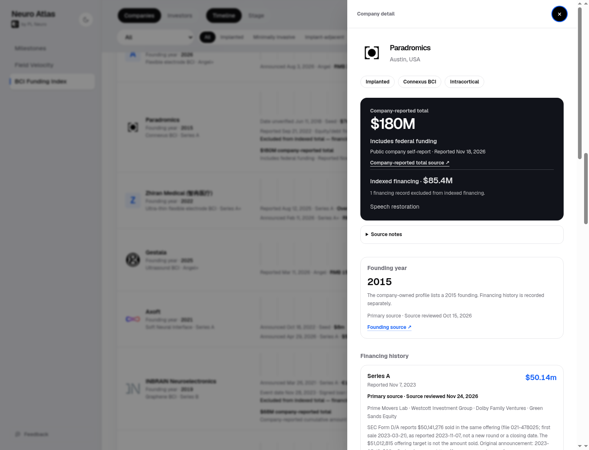
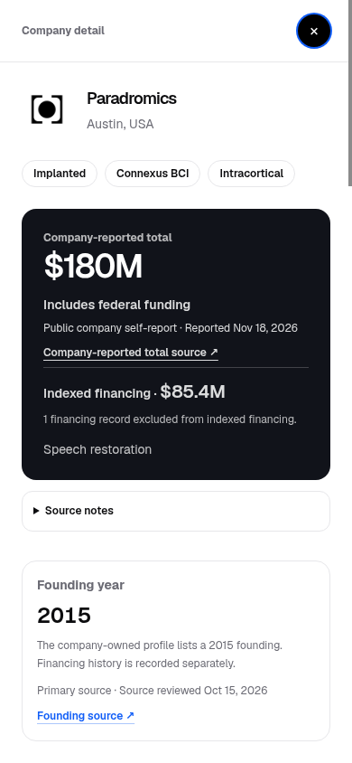
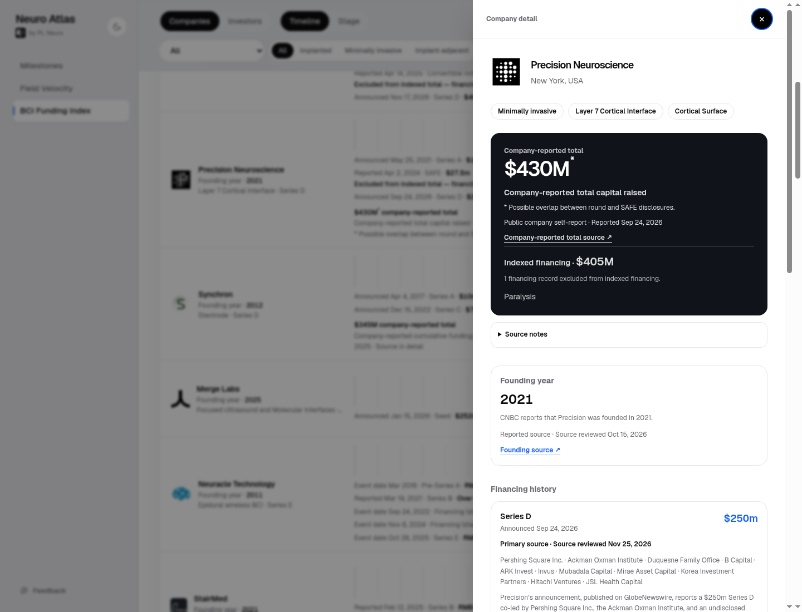
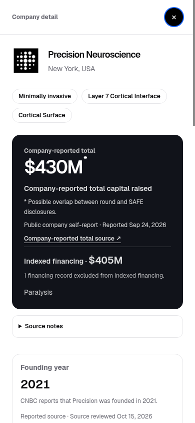

# Company-reported totals and financing records

Runtime/data checkpoint: `7144407300995d61cf7c971c9d8405c6efab16aa`. Verified application/test head: `35774fc9f29f8d0aac0fbea62320987743d6a10a`.

## Paradromics

The three additive documented disclosures total **$85.371876M**: $7M, $28.2306M and $50.141276M. The company detail displays **$85.4M indexed financing** alongside a separate **$180M company-reported total**, including federal funding. The cumulative figure links to [Matt Angle’s interview at 43:07](https://www.youtube.com/watch?v=JMQoWtsMBh0&t=2587s). Source notes retain the caption-review limitation and reporting date.

The $8.864853M equity/debt disclosure remains visible with its unresolved-overlap treatment. Company-reported totals remain separate from additive record accounting.

## Precision Neuroscience

The company headline remains **$430M***, attributed to [Precision’s September 24 announcement](https://www.globenewswire.com/news-release/2026/09/24/3368254/0/en/precision-neuroscience-closes-oversubscribed-250m-series-d-led-by-pershing-square-inc-the-ackman-oxman-institute-and-a-leading-life-sciences-investment-fund.html). The visible note reads: **“Possible overlap between round and SAFE disclosures.”** Indexed financing remains separately labeled **$405M**. The SAFE’s allocation is unresolved.

## Integrated copy and mobile presentation

The financing corrections retain the approved reader copy from #153 and its methodology-section removal. Source authorship, source hosts, dates, amount qualifications and accounting scope remain attached to their records. The Milestones badge identifies the actual **2024–26 visible timeline years**, while source-coverage year counts handle the undated record separately.

Qualified native amounts wrap within company-detail cards at 320px. The complete amount, currency and approximation/lower-bound wording remain intact. Period-level records, annual totals and selected-window timing qualifications retain their reviewed behavior.

## Verification

- Production webpack build and application/route typecheck passed.
- Standard complete suite: **1,844/1,880 passed**. All **36 inherited failure identities and actual/expected diagnostics** equal the exact new-main baseline (1,623/1,659); new/worsened diagnostics: **0**. The complete suite remains baseline-failing.
- Independent runtime/canonical integration, compatibility-infrastructure and bounded mobile/rebind reviews passed.
- Native Chrome checked both company totals and citations at 1440px and 390px, the annual period shelf, source context, and 320px native-amount bounds. Eleven served client assets matched the production build.
- Strict current-data checks bind 53 raw paths. Distinct historical compatibility endpoints retain all 33 original fixtures and scientific goldens. The source-only mobile successor changes one presentation line; canonical data is identical to the reviewed integration checkpoint.

[Verification summary](verification-summary.json) · [Screenshot hashes](screenshot-manifest.json) · [Financing source review](../../data/funding-index/source-review-20261125.md)

## Captures

Actual local production-build captures from the runtime checkpoint above. Hosted preview verification is recorded in the PR.

