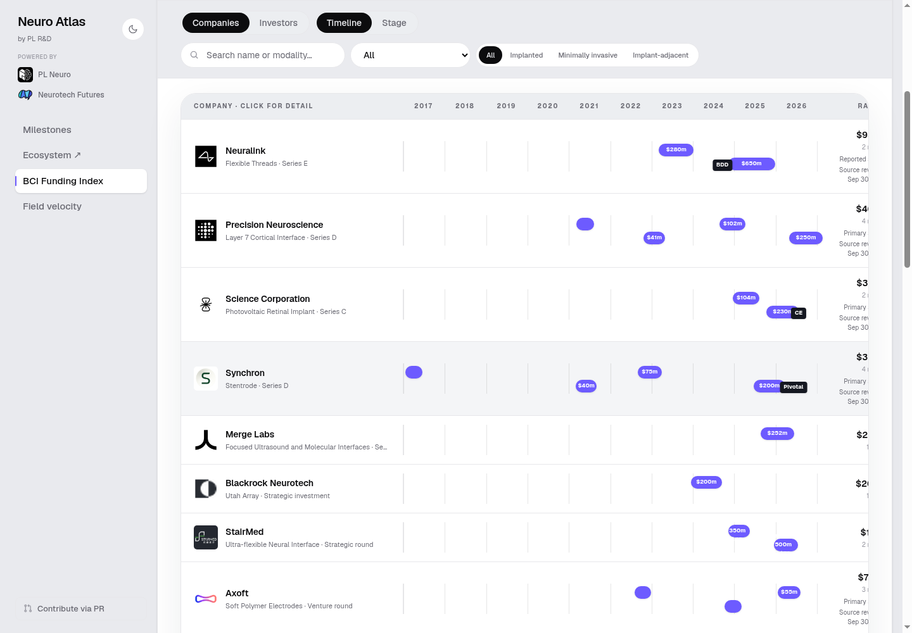
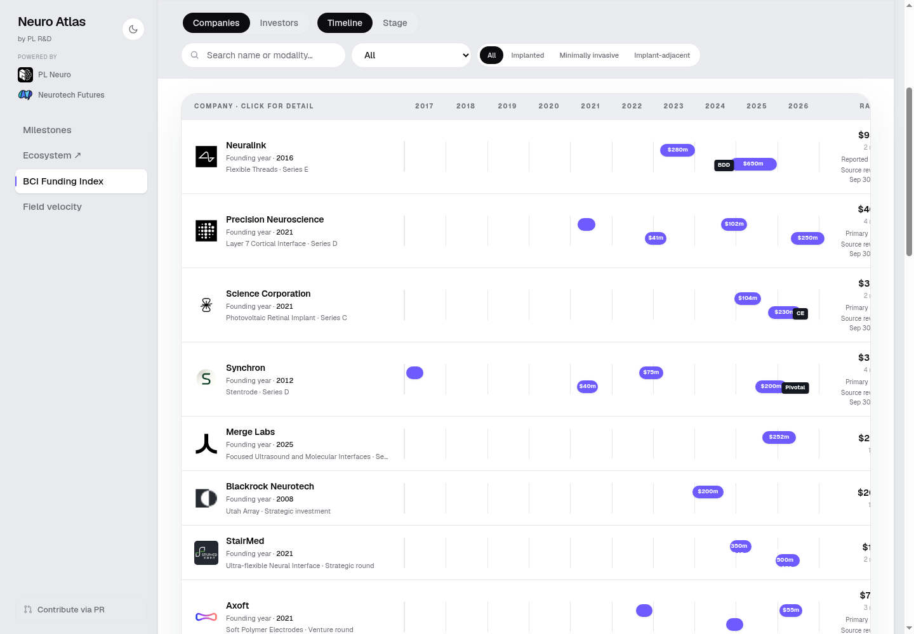
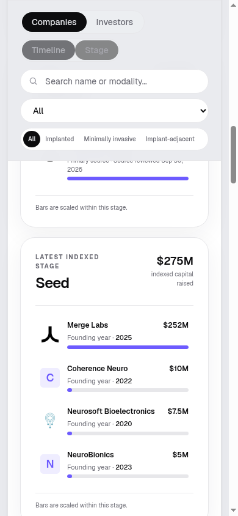
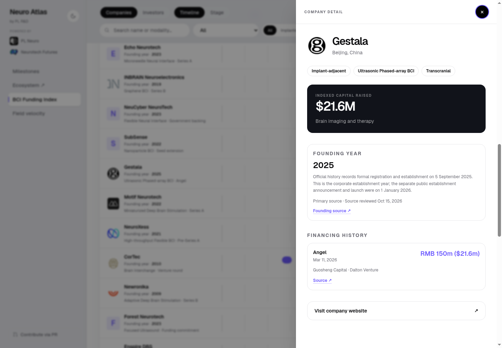
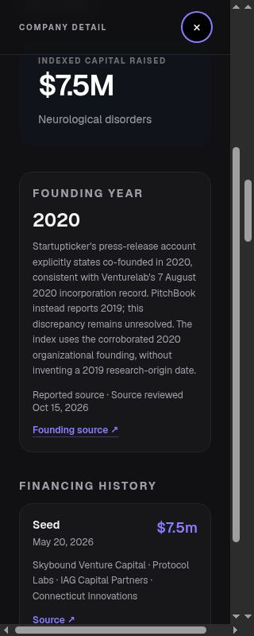
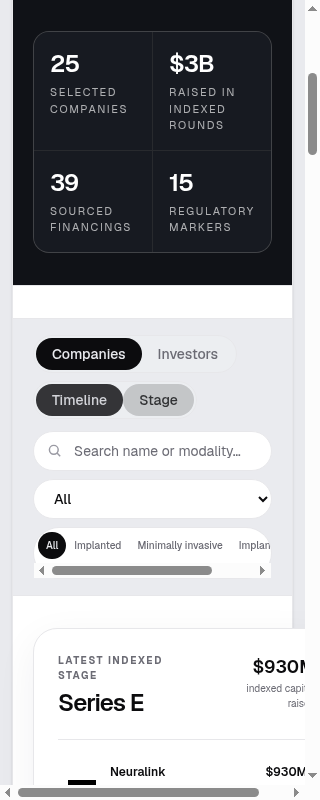

# Founding-year UI verification

**Local production-built fixture, not hosted verification.** The screenshots serve the actual `npm run build` output (`.next/server/app/funding.html` and compiled static assets) on loopback only. No production auth code was changed or credentials read. No deployment, push or PR was made by this workstream.

- Application/data revision: `5ff441529717e9682b1e4472398f0d78952965c9`.
- Independent before/baseline revision: `a7b14fde34e6c8629278233bffeaf9ae3d809630`.
- Both checkouts used their own `npm ci`, not a `node_modules` symlink.
- Browser: task-owned headed Chrome window; desktop emulation at **1440, 390 and 320px**, light and dark themes, Timeline and Stage views.
- Machine receipts: [browser-results.json](browser-results.json) (12 cases, actual HTML/data hashes) and [verification.json](verification.json).
- Replay probe: [`scripts/qa/founding-browser.py`](../../../scripts/qa/founding-browser.py), invoked through `browser-harness` with `ATLAS_QA_ROOT`, loopback `ATLAS_QA_URL` and `ATLAS_QA_SHA`.

## Acceptance

| Check | Result |
|---|---|
| Existing roster preserved | 25/25; no company added or removed |
| Source-linked founding-year coverage | 25/25: 17 primary, 8 reporting |
| Every rendered value matches canonical data | All 25 in both views across all 12 browser cases |
| New founding labels fit their company region | Pass, minimum 11px text |
| Details preserve source, reviewed date and caveat | Pass for Gestala and Neurosoft at all sizes/themes; automated UI tests cover every company's link in both views |
| Native row activation / source-link visibility / Escape | Pass |
| Search + keyboard Enter + source focus + Escape/focus restoration | Pass on Neurosoft |
| Missing/invalid-year behavior | Unit/UI tests: unknown remains null/Unknown, malformed values rejected |
| Deterministic generation | Exact repeat output verified; all non-founding payload fields match baseline |
| Full tests | **197 passed, 0 failed** |
| Typecheck / production build / changed-file lint | Pass |
| Repository-wide lint | **5 pre-existing errors**, independently reproduced on baseline; not changed here |
| Auth / noindex / basePath / dependencies | Unchanged |

**Known baseline limitation:** at 320px, the existing Stage card/header minimum-content width produces document `scrollWidth=340` versus `clientWidth=305` with native scrollbars. This was independently reproduced on untouched main and is unchanged by this feature. New founding labels and detail content remain contained and legible. Timeline uses its existing internal horizontal scroller; no new timeline width was added. This is not a claim of zero overflow everywhere, nor physical-phone touch or authenticated hosted QA.

**Data limitation:** no year is blank, but Neurosoft's 2020 selection retains the unresolved PitchBook 2019 discrepancy. Echo 2023 and Merge 2025 are explicitly secondary reporting, not primary incorporation verification. See the [source decisions](../README.md).

## Selected screenshots

### Timeline before and after — 1440px, light

### Stage cards — 390px, light

### Source-linked detail and origin distinction

### Narrow baseline comparison

The remaining PNGs retain each tested theme/width/view and both representative detail cases. Screenshots contain public company information only; no raw source reproductions or credentials are committed.
