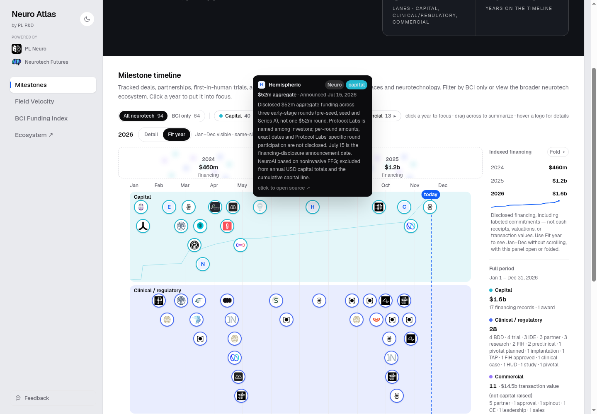
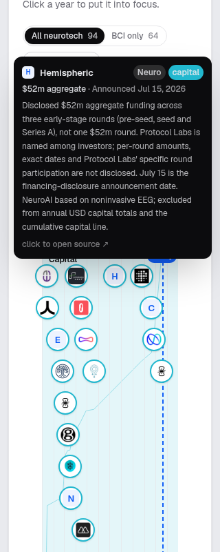
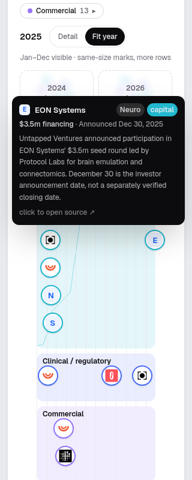
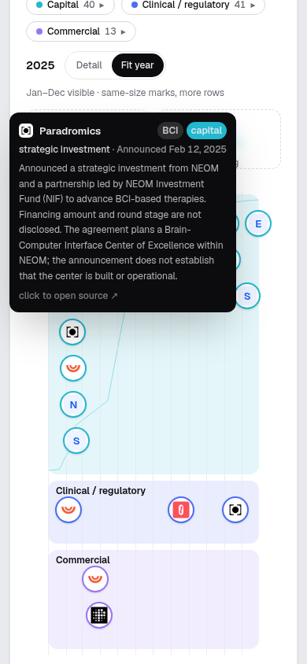

# Neuro-wide Milestones coverage — November 18, 2026

## Scope and sources

This change adds exactly three announcements to Milestones. It does not expand the separate BCI Funding Index or infer new investor-round participation from portfolio membership.

| Announcement | Source-backed event | Scope | Numeric capital treatment |
|---|---|---|---|
| EON Systems, December 30, 2025 | [Participating investor Untapped Ventures announced a $3.5M seed led by Protocol Labs](https://untappedventures.substack.com/p/untapped-ventures-invests-in-eon) | Broader neurotechnology: brain emulation/connectomics | Adds $3.5M to the 2025 disclosed-financing inputs; the date is the announcement, not a verified closing date |
| Hemispheric, July 15, 2026 | [CTech reports $52M across pre-seed, seed and Series A](https://www.calcalistech.com/ctechnews/article/rjentgbege); the [company-issued July 15 release](https://finance.yahoo.com/healthcare/articles/hemispheric-emerges-stealth-52m-funding-130000438.html) corroborates the amount, announcement date and named investors | Broader neurotechnology: noninvasive EEG/NeuroAI | The activity retains `$52m aggregate`; numeric `amountUsdM` is null because no amount can be assigned to this date as a distinct financing. Excluded from annual USD totals and the cumulative curve. One disclosure record, without three invented rounds |
| Paradromics, February 12, 2025 | [Issuer announced strategic investment from NEOM and a partnership led by NEOM Investment Fund](https://paradromics.com/news/neom-investment-fund-partners-with-paradromics-to-drive-innovation-in-neurotechnology-healthcare/) | BCI | Amount undisclosed: null, not zero. No financing amount added; no PL participation inferred. The planned center is not represented as an operational facility |

The click-through source for Hemispheric is the report that explicitly supports the three-round aggregate qualifier. All four source bodies were successfully re-retrieved on November 18, 2026. The raw research packet remains outside the application bundle.

## Data integrity

Base: `509ad21e8b33ef076bdcd055f26f4c4aedf011b1`.

Canonical inputs are `data/market-memo-q1-2026/milestones.csv`; generated output is `src/data/milestones.json`. Existing records and historical goldens remain pinned. The bounded historical adapter asserts every field of the three later records before removing only those records from older snapshot comparisons. An unreviewed field, duplicate or missing addition fails the adapter.

## Execution evidence

Tested application/data revision: `e6e4eec09ea7d236ef86c8e305d0453d92fa5bb2`. Final native QA script revision: `d8a0f591ef58740a7d1b27d7771a41e359ae8a2f`. The latter changes only the replay; application/data/test/package/config inputs are byte-identical to the built revision.

- `npm test`: **1,445 passed, 0 failed, 0 canceled, 0 skipped**; execution duration 581,110.890804 ms.
- Production webpack build and `npm run typecheck`: passed.
- Changed-file ESLint: passed. Whole-repository lint exactly matches the base's **3 errors / 12 warnings**; no introduced lint errors. The three existing errors concern the theme-toggle effect and two draft-chart test assignments.
- Native Milestones replay: **4 viewport widths (1440, 768, 390, 320), 12 event checks**. Every addition has its exact source link, announcement date, note and correct All neurotech / BCI-only behavior. The 2026 cumulative capital curve has no added $52M step.
- Exact local serving parity: **2 production-built HTML pages and 14 assets** matched their build bytes.
- Funding Index: **12 files byte-identical to base**, including generated data. Ordinary PL-family ranking remains **4 financing records / 4 companies / $859.5M associated whole-round financing**; the UI rounds that last value to $860M. It is not the investor's check size.
- The full coherent diff/source packet received an independent **PASS** at the tested revision. A final bounded review of the QA-only closure is recorded in `validation.json`.
- Task browser tab closed; all pre-existing tabs preserved; loopback viewer ports 37948/37949 closed.

### Replay qualification

The first native attempt measured a mark before Fit year's ResizeObserver finished repacking it and read a neighboring tooltip. The replay now requires stable painted bounds plus exact hit identity. A second attempt exposed an assertion expecting “undisclosed” where the reviewed text correctly says “not disclosed”; the assertion now checks that exact sentence. The final replay passed all 12 checks. Neither correction changed the application.

Local browser captures use exact Next production-built HTML/RSC/assets via a Host-restricted, noindex loopback viewer. They do not establish authenticated hosted behavior or physical-phone touch support. Before captures use an earlier production build whose runtime/data were verified identical to the pinned base; after captures use the tested application revision above.

Machine-readable receipts: `validation.json`, `invariance.json`, `parity.json`, `milestones-coverage-native.json`, and `investor-native-preservation.json`. `artifact-hashes.json` records the copied screenshot/receipt hashes.

## Representative screenshots

### Hemispheric — desktop and 320px

### EON and Paradromics — narrow layouts

