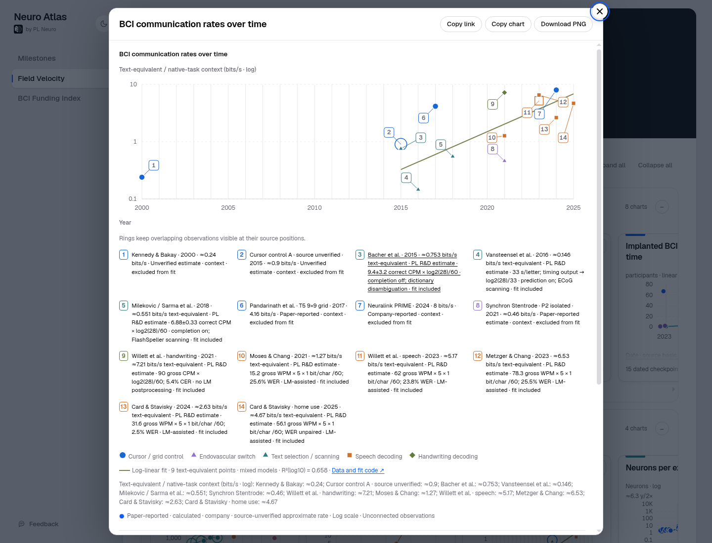
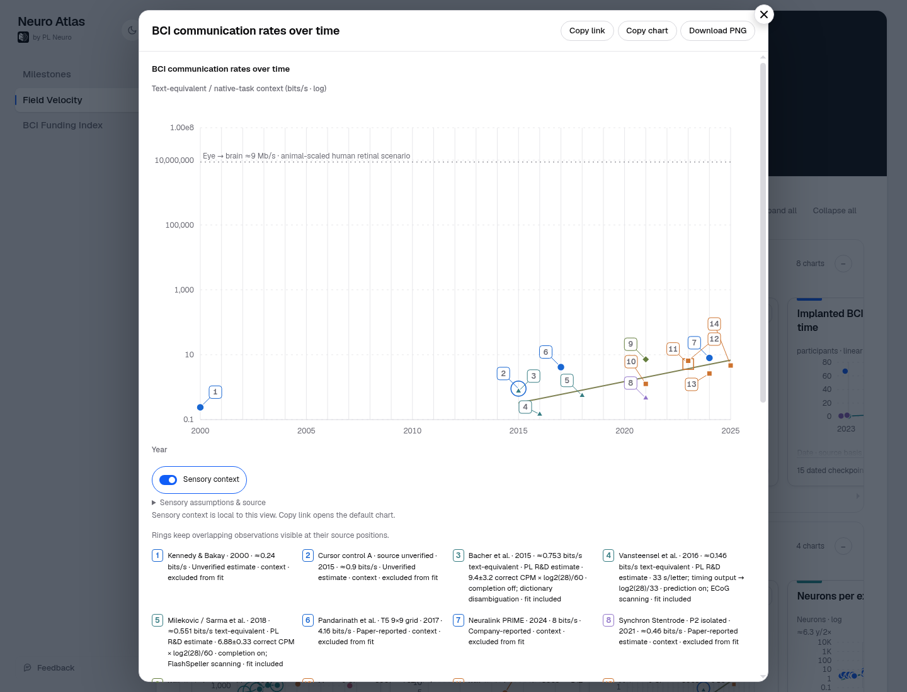
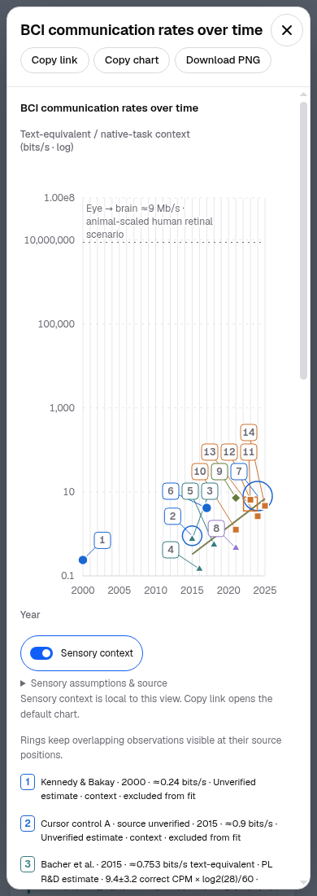
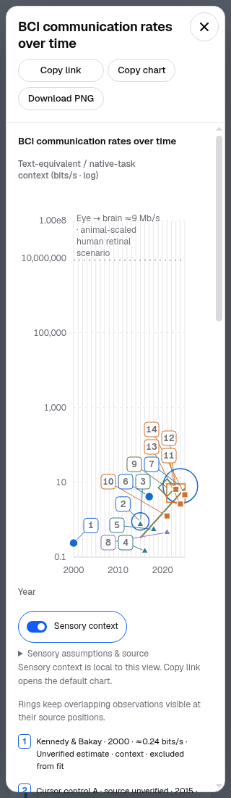

# Chart-only retinal bitrate reference

## Scope and source

Runtime **`a433ef4aa6958314a7c6918b37ea076be97951c9`**, based directly on main **`913eb58f69ef385b5e4fc2cbc02c532bdb7a8a13`**. This is independent of PR #134: no standalone graph pages, new chart URL framework, dashboard changes, new legend filtering/refits or extra hardware/body comparison lines. Current main's existing URLs and popouts remain intact. The only configuration addition disables automatic deployment of this feature branch.

The existing BCI popout now has a default-Off **Sensory context** switch. On adds one horizontal dotted reference at exactly **8,750,000 bits/s**, displayed as **Eye → brain ≈9 Mb/s · animal-scaled human retinal scenario** on the same logarithmic axis. [Koch et al. (2006)](https://pmc.ncbi.nlm.nih.gov/articles/PMC1564115/) supplies the guinea-pig independent-channel estimate; the explicit human proportional scaling and correlation/species limitations stay below the chart. This is context, not a measured human capacity or BCI fit input.

The optional view expands only display bounds and height. All 14 source observations, 9 fit inputs, model/source tables and downloads remain unchanged. Off restores the original SVG and native default-image content. **The new switch is local state; Copy link opens the existing default chart.** PNG and Copy chart capture the actual enabled reference and qualified label.

## Verified

- Production build, generated Next types and scoped lint pass.
- **92 affected-scope tests pass**. Separate independent source/mathematical review passes with **25 focused tests**, exact-rate/source-coordinate probes and **30 exact original-main default/preview SVG comparisons**. These are separate scopes, not a combined full-suite total. The parent also regenerated the committed SVG fixtures from the untouched main worktree.
- Actual headed Chromium at **1440/390/320px**, light and dark: reference placement independently calibrated from rendered log ticks; year/reference glyph bounds; all 14 marks and numbered keys; unchanged source rows/fit; exact Off SVG; no URL mutation from the new control; old BCI aliases; Escape and reopen.
- Three other actual charts—public image footprints, neural recording hours and tissue checkpoints—match baseline SVG/rows/mark identities exactly. Fourteen frozen source/routes/URL/export/config objects match main.
- Real Download PNG produces **2400×2840** pixels with the dotted reference, qualified label, original study key and branding. Native Copy chart clipboard readback has identical pixels. Off chart/legend/study-key pixels match the **2400×2232** original-main image; only the different localhost source-URL footer is excluded from that pixel comparison.
- **12 served JS/CSS assets** match exact build bytes. GET/HEAD checks keep the existing Field velocity route healthy; the unintroduced standalone BCI path remains404.

## Honest limits

The bounded full-repository run hit **300 seconds, exit124, with no aggregate**; it is not green. Three failures were observed: two chart-sharing `null.textContent` cases at `tests/chart-sharing.test.mjs:207,252` reproduced unchanged in paired baseline/candidate replays; an analytics-history case failed in the broad run but passed isolated on both. No root cause is inferred and no unrelated fixes are included here. Initial baseline 60-second link-harness timeout/fixture failures are retained; a clean larger-bound rerun passed all6cases.

Viewport/pointer emulation is not physical-phone certification. Screenshots and native exports below are from exact local production builds, **not a hosted deployment**. No merge, preview deployment or production change was performed for this PR.

## Actual local screenshots

Before, main913eb58:

After, runtimea433ef4:

Compact execution receipts: [verification](verification.json), [native replay](native-report.json), [scope/source custody](scope-report.json), [HTTP and asset bytes](http-assets.json).
