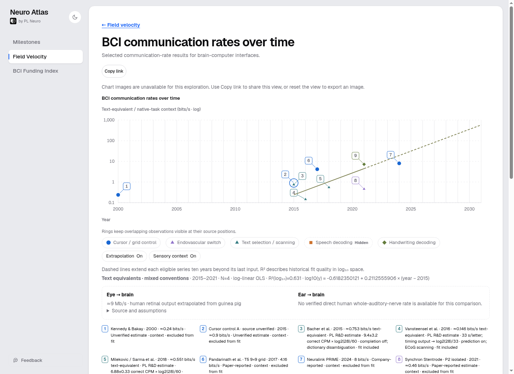
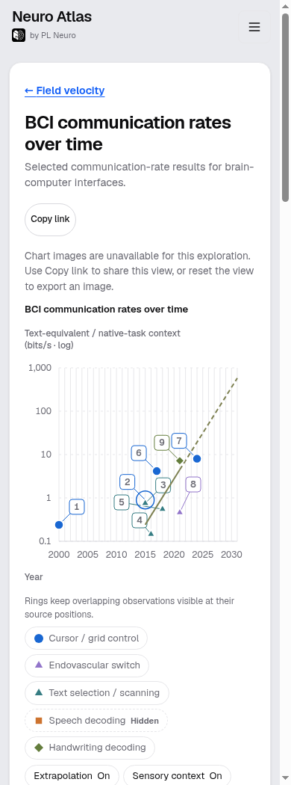

# Exact single-chart view URLs — November 20, 2026

Owner: “each selection in the legend should change the URL though so i can really send exactly the chart that i made.” Adds URL sharing to the existing one-chart-per-page scope in draft PR134 / PLR-136. No custom dashboards, merge or production release.

## Verified artifact

Runtime `c56b76f6183cc2b1ed00858f1464133612bb3182`. The actual headed-Chromium captures below use an isolated local production build at `/neuro-atlas`; subsequent media/documentation-only commits have no runtime/test/config delta. Manual preview verification is separate and linked from the PR.

• Every existing interactive legend writes a readable, bounded, chart-qualified URL immediately. The same URL/Copy link restores visible marks and eligible fits, recording view and companion exploration options. No browser-local saved chart or dashboard is needed.
• Native **19 legend/view journeys** passed fresh-document exact state/data/encoding comparisons across BCI, acquisition, all four recording views, annual publication comparisons and Trends. Multi-action BCI N=9→4, sensory context, real Back/Forward, reload, actual clipboard readback, all-hidden/reset and three companion settings journeys passed. Three old BCI fragments still resolve. Viewports 1440/390/320 have no document overflow.
• **152 affected-scope root tests**, **21 prefixed state/alias tests**, production build/TypeScript and zero-warning scoped ESLint passed. Independent component probes cover all **32 BCI hidden-series subsets**, model settings/reset and fresh-mount/URL privacy parity; **51** additional adversarial groups passed. These are distinct layers, not one invented aggregate.
• Independent bounded review PASS at the runtime above; **14 actual served JS/CSS files** matched the pinned build bytes. All source data/scientific math/auth/dependency locks are unchanged. The frozen 150-alias compatibility contract passed; the prior complete native150 replay remains historical evidence, not a new 150-case browser claim here.

## URL and export contract

`chartHidden`, `chartModel`, `chartBaseline` accept only fixed chart-qualified tokens, each at most512characters and one occurrence. Repeated/unknown/duplicate/empty/oversized/wrong-chart values safely default independently. Existing `recordingView` enum remains supported. Defaults remove state params; Show all resets the legend without erasing separately selected models. Navigation retains relevant unrelated repeated queries; canonical Copy link strips arbitrary queries/userinfo and cannot transfer another chart’s state.

Copy link remains available for filtered views. Unsupported selected-view PNG/copy-image output remains disabled with image-specific guidance. Capture, DOM and URL state must agree before supported images are serialized. No export is presented with a different live view’s link.

## Actual local interface

## Honest limits and diagnostic history

• Not a full-repository-suite green claim. Baseline130 and final152 affected tests completed. An optional unchanged baseline raster/sharing run was stopped after17passing cases without aggregate; an additional baseline navigation bundle timed out180s with35passes/1cancelled. These are not candidate failures.
• Two unchanged persistent-page test fixtures hardcode a root pathname. Forcing the public-prefix environment into them fails on the previous runtime and this runtime identically; those fixtures pass in their normal root run. The new prefixed state/alias suite and actual prefixed production HTTP/native routes pass. No compatibility assertion was weakened.
• Initial native ownership check used browser-level Target.getTargetInfo rather than the owned page’s current_tab handle; corrected before page mutation. A CSS-selector Unicode escaping bug stopped after five accepted BCI journeys; the final replay restarted all cases against the corrected runtime. These are harness diagnostics, not omitted cases. An annual-plot geometry comparison did not reproduce in an isolated unchanged-source replay; final captures wait for settled fonts/layout.
• Native narrow-width testing caught a real new issue: placing the image-only guidance inside max-content action tracks expanded the document to843px at a390px viewport. The final source places that note in a normal sibling block, adds a RED→GREEN regression, passes bounded independent rereview and reruns the native suite after rebuild.
• Responsive Chromium viewport/pointer checks are not physical-phone touch certification. Hosted preview/source verification is not a production proxy release. Underlying source data and scientific caveats remain the same; no new forecasts or observations were manufactured.

Exact private receipts: `/opt/data/records/neuro-atlas-legend-urls-20261120/` (internal-only). This repository manifest/captures are the shareable record.
