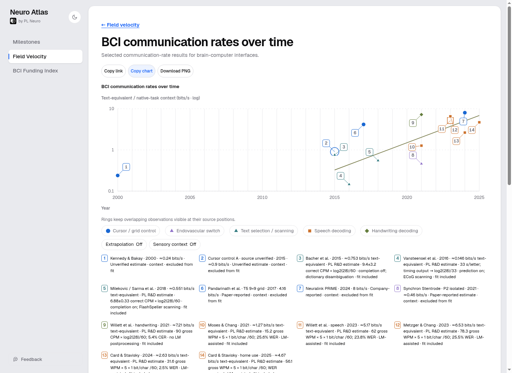
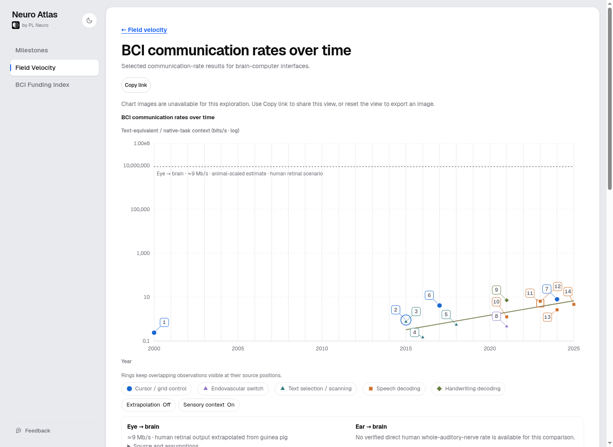
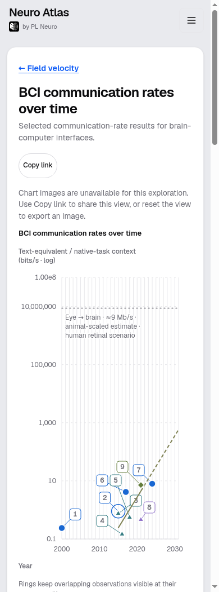
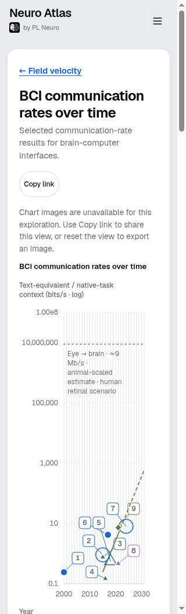
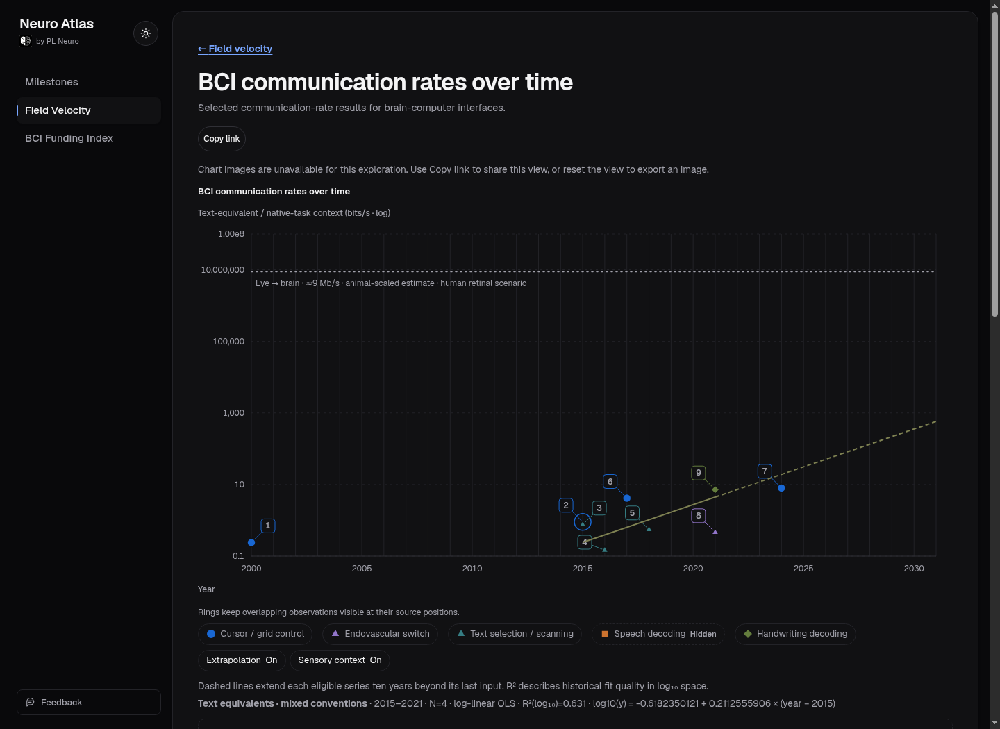

# In-chart sensory reference — November 20, 2026

Owner request: sensory context should be an actual dotted bits/s line across the BCI log chart, rather than only explanatory text below it. This preview-only follow-up keeps one chart per standalone page; no dashboard/composer was restored.

## Actual output

Sensory context is off by default. On adds a neutral dotted horizontal reference at **8,750,000 bits/s**, with a visible **Eye → brain · ≈9 Mb/s · animal-scaled estimate · human retinal scenario** label. The log display domain and plot height expand; the full original BCI source observations remain. Turning it off restores the exact original SVG. The narrowest view uses fewer calendar labels, preserving every year guide and original observation coordinate. The label is separate from the numbered study key and the conditional BCI fit.

The [Koch et al. primary paper](https://retina.anatomy.upenn.edu/pdfiles/6728.pdf) supplies the independence-summed guinea pig estimate; the human number is the existing proportional cell-count scenario. Full source/scaling/correlation assumptions remain below the plot. No direct human optic-nerve capacity, auditory value or BCI performance ceiling is asserted. Biological/hardware comparison options were researched separately, not added in this patch.

## Verified runtime

`c3908714f89d888baae445960c87e0cb7a58352a`. All captures here are the actual loopback production build at that runtime, not hosted or physical-phone screenshots. Later evidence-only changes do not change runtime/tests/config.

- **103 affected-scope root tests**, **21 prefixed state/alias tests**; production build/TypeScript and scoped ESLint pass. Standard test files include the new mounted regressions.
- Independent exact-revision code review/targeted probes pass; review summary in verification.json. RED→GREEN receipts were retained privately for line placement, wrapping, clearing pinned inspection, scientific disclosure, and the native-discovered narrow calendar-label correction.
- Real headed Chromium at1440/390/320px and light/dark: exact-rate line independently checked against actual log ticks, visible label bounds, year-label spacing,14original marks/source rows, eligible refitN9→4, all-hidden/reset, fresh URL/reload/native Back/Forward and actual Copy link/clipboard replay pass. Reference never enters observations or the fit. DefaultOff SVG restores exactly.
- Complete BCI data/derived evidence/descriptive fit serialize byte-identically to the pre-change source.11frozen source/model/config objects are unchanged. Independent baseline render comparisons cover63exact SVG/source states across15plots.
- All25graph pages GET/HEAD plus unknown/retired404 cases pass (52checks); preview noindex preserved.14served JS/CSS files match the pinned build bytes. Auth, feedback/analytics, URL registry and deployment guards unchanged.

## Actual captures

Default before this follow-up:

Sensory-only view (all observations):

Selected/refit+sensory view at390px and320px:

## Limits retained

- Preview-only; no merge/production deployment or alias promotion. The feature branch still conflicts with newer main and requires reconciliation/reverification before any eventual merge.
- Selected/model image export remains deliberately restricted; Copy link shares this exact view. No claim of arbitrary filtered/scenario PNG support.
- A once-bounded full-repository run at intermediate7638d60 timed out after300seconds (exit124), with failed/timed-out worker cases. It is **not a green full-suite aggregate**, and those failures were not relabeled as unrelated without replay. Final affected-scope tests above pass; the full-suite limit is separate.
- Viewport/pointer emulation is not physical-phone certification. Prior150-native-alias and original PNG checks remain historical evidence, not re-dated as part of this focused visual follow-up.
