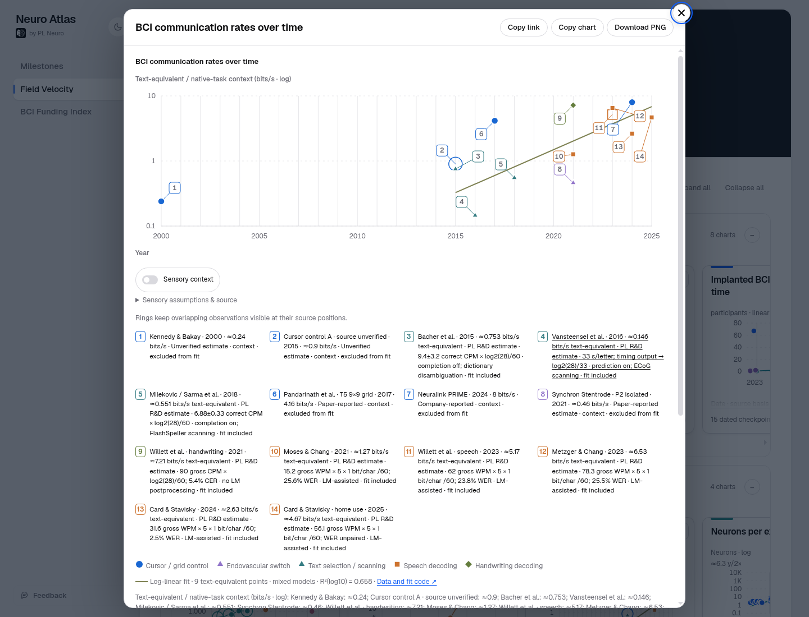
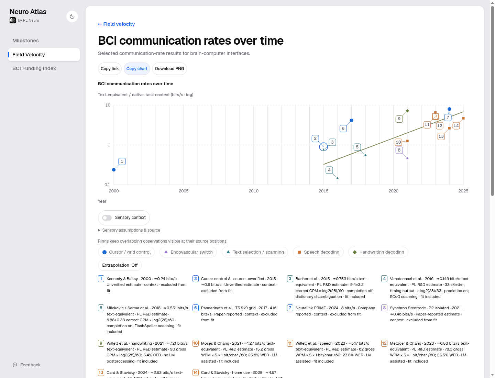
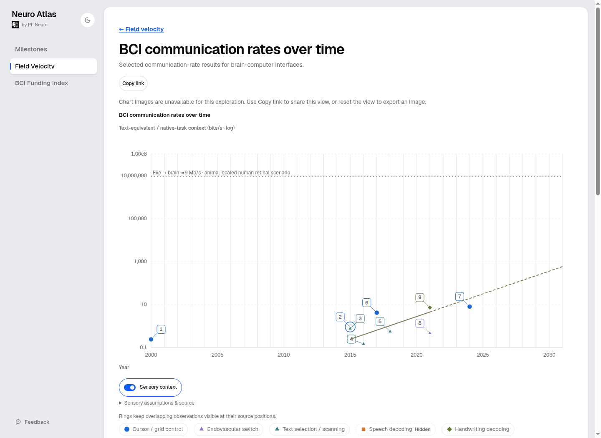
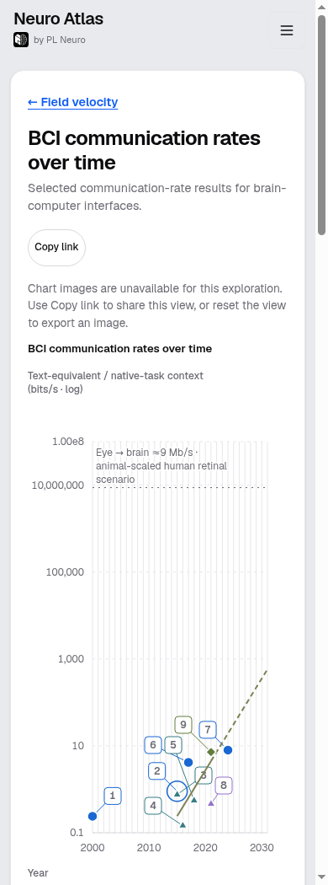
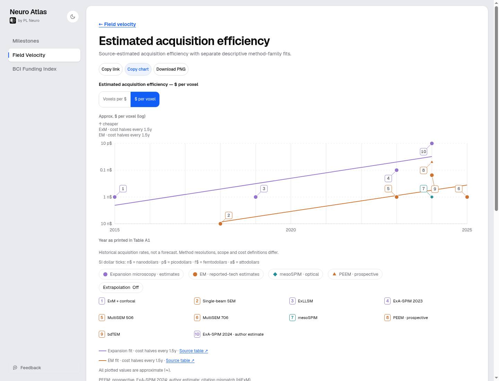
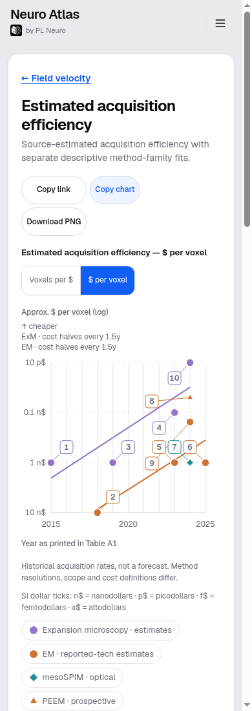

# Shareable single-chart pages — local verification

**Runtime:** `4a5cc6d8a0e196b3a2579c81b0802c8bbd5479ec`. **Current-main reference:** `bc92a0bee01d9490808cd501279eef008048568c` (includes merged #141 and #142).

This is the separate remaining-work layer: 25 persistent single-chart pages, exact selected-view URLs, legacy-fragment compatibility, visible-eligible legend refits, and return-to-overview state. It preserves the merged retinal bitrate visualization, source layouts/recording coverage, and historical-first acquisition chart with both approved units. No custom dashboard builder is introduced.

**No deployment or merge.** All captures and native PNGs below come from an actual local production build. The older #134 hosted preview is historical and does not show this branch. Feature auto-deployment remains disabled.

## Verified at the runtime above

- Production build and generated TypeScript: pass. Scoped ESLint: 82 files, zero errors, three unused-variable warnings.
- Final serial critical regression command: **74/74 pass**, zero failures, cancellations or skips. Includes standalone state/acquisition/source-frame, frozen legacy map, all persistent pages, export-view custody, merged sensory, and source/reference regressions.
- Fresh native browser comparisons across **25 pages** retain current-main source observation identities/values, complete source rows/links and specialized selectors.
- **150 independently frozen old fragments** land on their exact chart or explicit category/tab fallback, retaining repeated unrelated query entries. Three main toggle journeys restore their actual enabled state. The newer reciprocal acquisition fragment is separately verified.
- **19 legend cases**, all-hidden/reset, fit **N9 → N4**, actual Copy link, fresh documents, reload and native Back/Forward restore the selected view. Tissue/voxel, publication baseline and whole-brain companion views remain.
- **15 source-frame cases** across five chart families at 1440/390/320px: equal desktop definition/source columns, narrow stacking, full source rows and readable horizontally contained tables; recording hours retains its paired coverage bars.
- Acquisition: both y units, reciprocal numeric conversion, original source-download URI and complete table rows, efficiency-only reference clearing, exact filtered refits, neutral title, fresh/reload/history/clipboard, and a real native reciprocal PNG.
- Merged sensory visualization: default Off exact restoration, qualified 8,750,000 bits/s log-axis reference, unchanged 14 observations/source rows/fit; light/dark and 1440/390/320px plus native PNG generation.
- Overview search, group preferences, rail positions and focus restore. **Vertical scroll is not exact:** native returns showed 4px and47px residuals, including Forward (606px target,559px observed). This remains a disclosed nonblocking follow-up, not a green pixel-restoration result. Recording optical actual PNG/clipboard and mobile current-section/Escape/focus are verified separately.
- **52 HTTP GET/HEAD/404 cases**, 25 canonicals, **14 exact served asset byte matches**, four private-file404s. 139 frozen current-main source/config objects match; only the documented registry/source-index extensions differ.
- Independent initial review and bounded closure of F1/F2, followed by a bounded exact-current-main/acquisition reconciliation review. See [review summary](review-summary.md).

## Screenshots and native outputs

Captures use headed Chromium at emulated viewport widths, not physical phones. Source revision for each image and its SHA-256 are in [manifest.json](manifest.json).

| Current-main popout before | Standalone default after |
|---|---|
|  |  |

| Exact selected view, desktop | Same exact URL, 390px |
|---|---|
|  |  |

| Acquisition reciprocal, desktop | Acquisition reciprocal, 390px |
|---|---|
|  |  |

Additional evidence: [320px exact view](exact-view-mobile-320.png), [desktop source frame](sources-desktop.png), [320px recording source table](sources-mobile-320.png), actual [retinal PNG](native-sensory.png), [reciprocal PNG](native-acquisition-reciprocal.png) and [optical recording PNG](native-recording-optical.png). Native image footers intentionally identify the local origin on which they were generated; these are not hosted-preview captures.

## Limits / retained failures

**Known native follow-up:** overview vertical scroll can drift on return/Forward even though search, group preferences, rail positions and focus restore; up to47px was observed. The root cause is not established. This is not a completed pixel-exact restoration claim.

Earlier broad aggregate runs timed out. **No all-green full-repository or CI claim is made.** Final 74-test scoped pass is separate from those failed receipts. Lint warnings are listed above, not hidden as an error-free-and-warning-free run.

Filtered/refit/unsupported modeled images remain explicitly link-only; Copy link stays available. Supported merged sensory/acquisition/recording PNGs are exercised natively. Bulk/offscreen export custody passes mounted tests, not a claimed native all-chart raster replay. Recipient-editor paste behavior, physical-phone touch, hosted/proxy deployment behavior and production activation are not certified here. No source values are fabricated to fill any gap.

See [legacy URL map](legacy-url-map.json), [25-page source parity](source-parity.json), [served asset hashes](served-assets.json) and [manifest](manifest.json).

The earlier combined native batch stopped on a harness assumption: it awaited image-export registration on a deliberately link-only filtered acquisition view. The actual view was hydrated. The corrected targeted replay waits for owned chart state/controls, retains strict registration checks for supported PNGs, and completes acquisition/core checks separately. That stopped aggregate is not relabeled green.

Final focused command (from the repository root):

```sh
node --import tsx --test --test-reporter=tap --test-concurrency=1 \
  tests/standalone-acquisition-reconciliation.test.mjs \
  tests/standalone-chart-state-contract.test.mjs \
  tests/standalone-chart-state.test.mjs \
  tests/standalone-main-reconciliation.test.mjs \
  tests/standalone-support-frame.test.mjs \
  tests/graph-export-view-binding.test.mjs \
  tests/bci-sensory-context.test.mjs tests/frozen-legacy-graphs.test.mjs \
  tests/persistent-graph-pages.test.mjs \
  tests/acquisition-metric-url-integration.test.mjs \
  tests/acquisition-metric-urls.test.mjs \
  tests/exploration-reference-integrity.test.mjs
```
