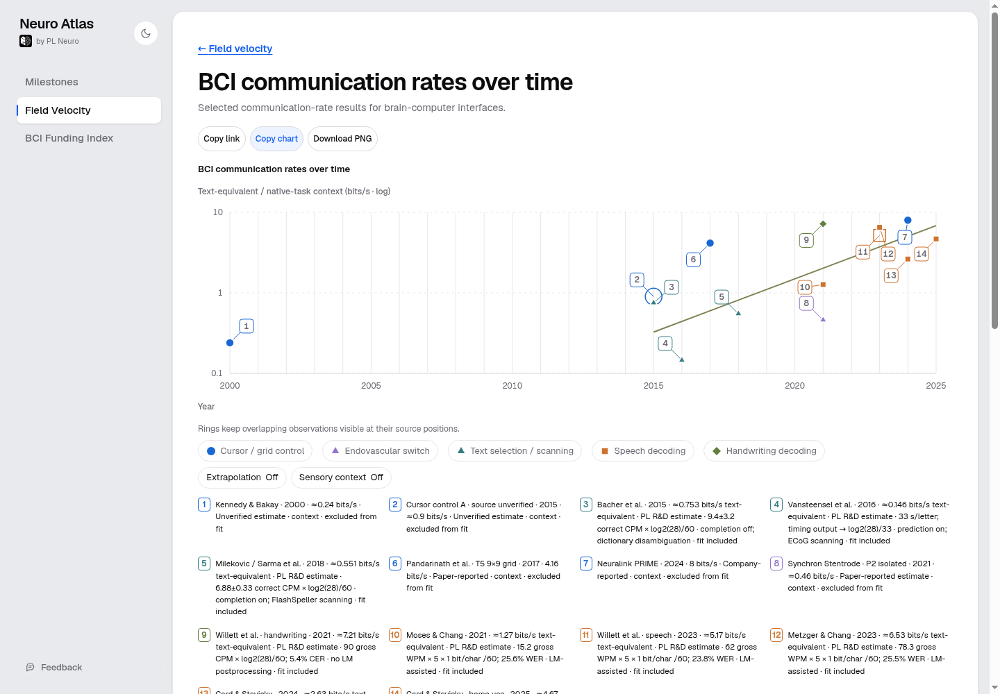
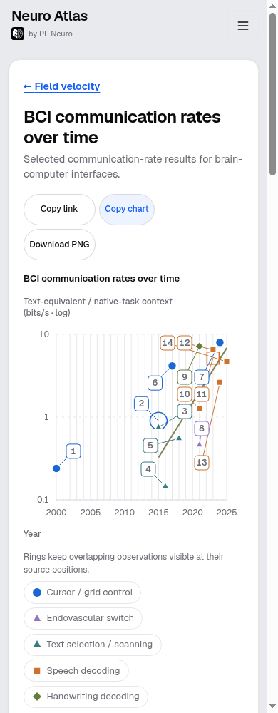
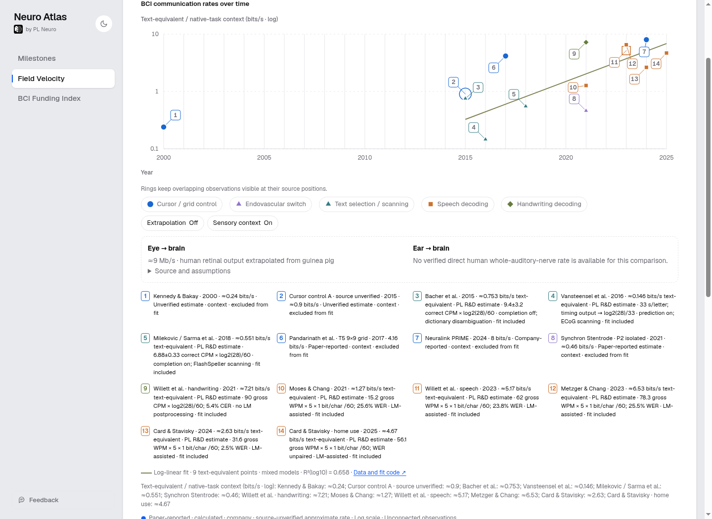
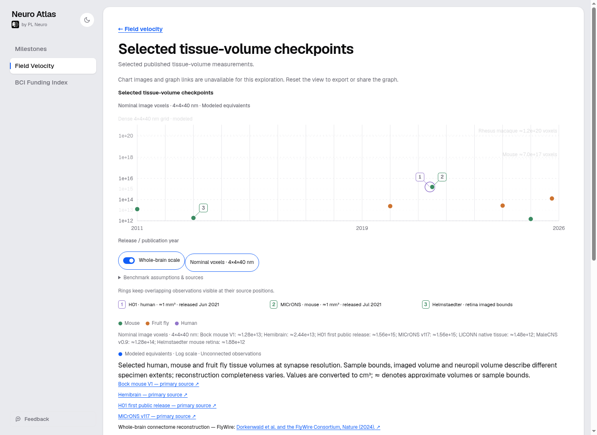
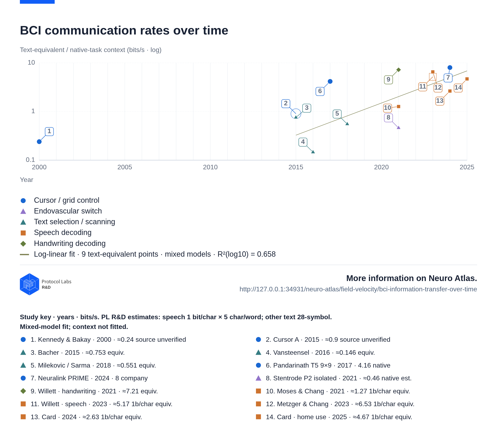

# Single-chart pages — removal follow-up, November 20, 2026

## Scope and source

The current product is **one real chart per standalone page**. Custom composition, add/remove/reorder, named saves, dashboard sharing and reflow/bounce machinery are removed. The existing Field velocity catalog and unrelated Funding features remain. This is PR134 / PLR-136, **preview only; no merge or production approval**.

Runtime/source: `bcec57e492a4f31091d1d7784e03d81c82284b6b`. All screenshots below are actual headed-Chrome captures of its local production build, not hosted images or synthetic chart fixtures. Later evidence-only commits do not change runtime/tests/config. The original comparison candidate's evidence in `../persistent-graphs-20261120/` is historical and superseded for current product scope.

## Verified at this runtime

- Parent affected-scope suite: **130 passed, zero failed/skipped**, covering 22 files. Production build/TypeScript passed. Changed-source ESLint: **zero errors/warnings**.
- Independent bounded code review: **PASS**, no introduced P0/P1. It independently checked 20 unchanged objects/trees and retained scientific/export assertions; its root/prefixed probes and 811 adversarial helper assertions are distinct from native evidence.
- Actual native rendering: **25 single-chart pages**, with exactly matching plotted data attributes, source-table text and specialized selector values/options from an independently frozen pre-removal hosted snapshot. No compose/add/save/share/reorder entry points remain.
- Native legends: BCI marks 14→9; eligible fit N=9→4. Retinal context, anatomical reference lines and nominal voxel projection remain usable. Original scientific inputs, all public assets, the frozen 150-fragment fixture, link registry/translator, fit/reference models and return-state code are Git-object-identical to the previous candidate.
- **150 historic fragments** replayed through actual hydration to their exact chart/tab/category fallback, with repeated safe query values preserved. Valid retired `dashboard?add=<slug>` links recover to that single graph and valid recording view; opaque `#d=` comparisons recover to Field velocity without decoding or touching local saves.
- **52 production-build HTTP checks**: GET+HEAD for all 25 graphs; genuine 404s for unknown/retired standalone slugs; preview noindex headers.
- Actual Chromium BCI PNG: **2400×2126**, 14 source observations, correct stable filename/footer URL and unchanged navigation. Real raster bytes were decoded and inspected; no OS filesystem-download or recipient-editor paste claim.
- Desktop 1440px and viewport-emulated 390/320px, light/dark, with document bounds checked. This is pointer/keyboard browser evidence, not physical-phone touch certification.

## Honest execution limits

The broad repository suite was intentionally stopped before a terminal aggregate after unchanged clipboard/raster cases took many minutes; it is **not claimed green**. The 130-case affected-scope run above completed independently with exit 0. Independent review also reproduced a pre-existing queued-export test timeout/fixture-isolation flake; a clean rerun passed. It is not an established product regression, and no custody assertion was removed to suppress it.

The first native runner reached 25 graphs and 92 legacy aliases before its 600-second foreground budget ended. Completion resumed from the exact frozen prefix, re-exercised controls/retired-link journeys, and completed all 150 aliases; the timeout and environment-selection diagnostic remain in private logs rather than being relabeled as successful first runs.

Unsupported selected-view images/links remain unavailable with reset guidance. Metric-specific extrapolation and reference assumptions remain separate from observations. Previously reported default-branch dependency alerts remain separate maintenance work; manifests/locks are unchanged.

## Actual captures

